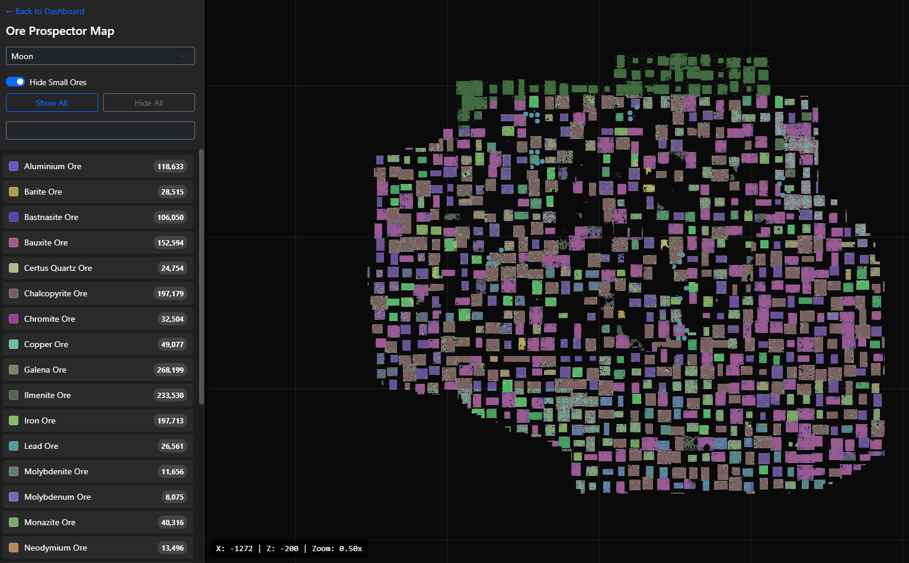
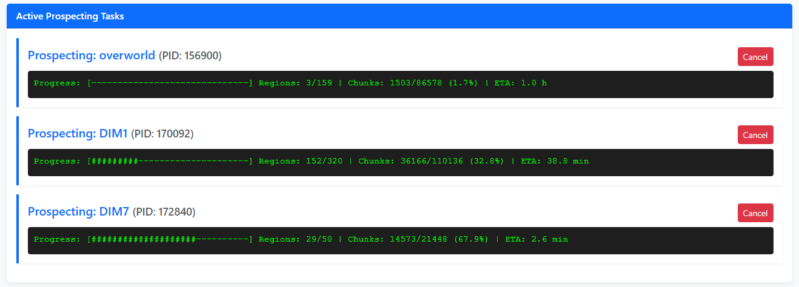
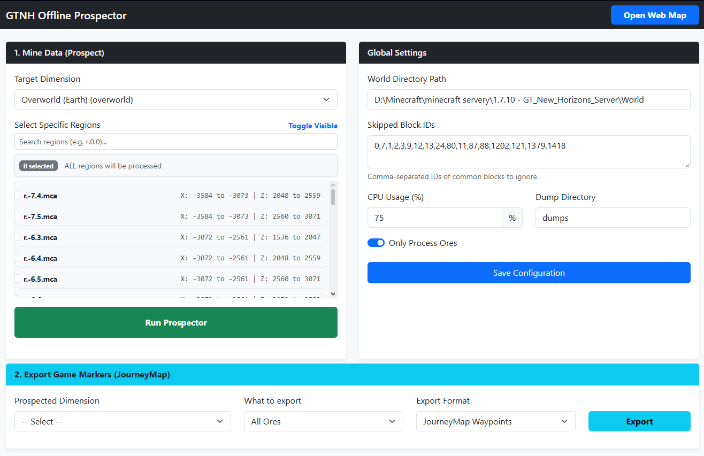

# GTNH Offline Prospector

An optimized offline web application for parsing and rendering GregTech New Horizons (GTNH) Ores directly from `.mca` region files.

## Prerequisites: Data Dumps
Before using the prospector, you must extract block and ore dictionary data directly from your GTNH instance using NEI (Not Enough Items).

1. Launch your GTNH instance and load into a world.
2. Open your inventory and click the **Options** button (bottom left corner) to open the NEI Config.
3. Navigate to **Tools** -> **Data Dumps**.
4. Click on **Blocks** to generate the block dump.
5. Go back to Data Dumps, select **NEI Integration**, and dump the **Ore Dictionary**.
6. Open your `.minecraft/dumps/` folder, find `block.csv` and `oredict.csv`, and copy them into the `dumps/` folder inside this application's directory.

## How to Start
1. Ensure you have **Python 3.8 or newer** installed from [python.org](https://www.python.org/).
2. Run the application depending on your operating system:
   - **Windows:** Double-click `start.bat`.
   - **Linux / Mac:** Run `./start.sh` from the terminal.
3. Once the web interface opens, navigate to the **Global Settings** panel on the right side of the screen.
4. Set the **World Directory Path** to your target world folder. This can be either a singleplayer save (e.g., `.minecraft/saves/MyWorld`) or the root world folder of your dedicated server.

The launcher scripts will automatically check your Python installation, set up an isolated virtual environment (`venv`), install all required dependencies (`Flask`, `anvil-parser`), and safely start the local server.

## Features

### Data Mining (Prospecting)
Parses huge `.mca` region files extremely fast utilizing multiprocessing. You can select specific dimensions, specific regions, and skip unwanted non-ore blocks to save space.

### Canvas Interactive Map & Dashboard
View all prospected ores on an infinitely scalable, high-performance offscreen canvas layout. Hover over ores to see a precise tooltip with coordinates and combined ore details. The built-in dashboard lets you configure everything easily.

### Export Markers
Convert your prospected data into `.json` waypoint files ready to be pasted straight into your **JourneyMap**! The exported waypoints will automatically point to the thickest center of each ore vein.

## Requirements 
- Python 3.8+
- Flask
- anvil-parser

## Images

